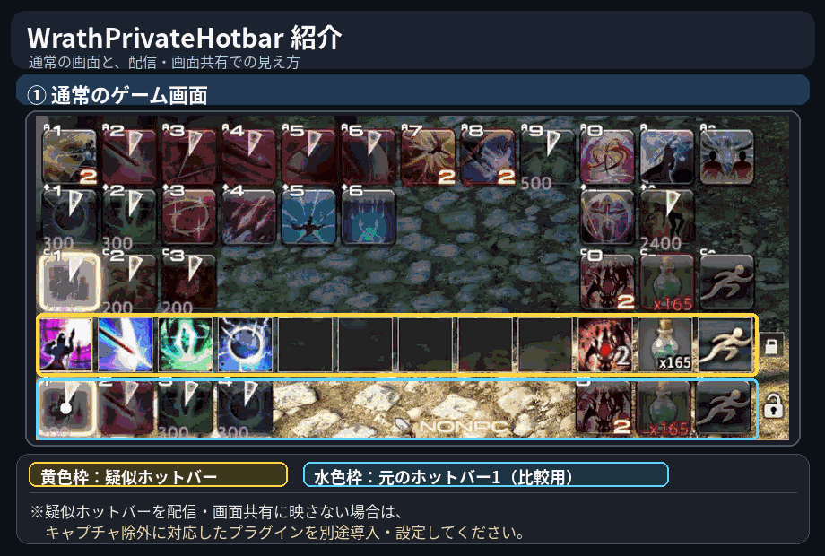

# WrathPrivateHotbar

**WrathComboのスキル自動置き換えを、指定したホットバーだけに限定するFF14用Dalamudプラグイン。**

ほかのホットバーはFF14本来のアイコン・ツールチップ・スキル実行を維持しながら、操作できる「疑似ホットバー」を画面上に表示できます。

> **対応操作：キーボード・マウスのみ**（ゲームパッド・クロスホットバー非対応）

## 動作イメージ



- **前半：実際のゲーム画面** — 一番下の黄色い枠が疑似ホットバーです。スキル使用・リキャスト・発光の様子を確認できます。
- **後半：Discord画面共有の一例** — 対応するキャプチャ除外環境を利用した場合の見え方です。

**注意：疑似ホットバーが配信・画面共有から自動的に消えるわけではありません。** 配信映像に映さない場合は、別途キャプチャ除外に対応した環境を準備・設定し、必ず事前に録画または画面共有で確認してください。

## 何ができる？

| 機能 | 内容 |
| --- | --- |
| WrathComboの適用範囲を分離 | 指定したホットバーではWrathComboの自動置き換えを利用し、それ以外はFF14本来の動作を維持 |
| 疑似ホットバー | 画面上に別の操作可能なホットバーを表示。元のホットバーは必要に応じて非表示にできます |
| スキル情報 | リキャスト残り時間、チャージ数、アイテム所持数を表示 |
| 操作時の演出 | 発光・押下アニメーション・リキャスト進行表示などの純正風表示（完全な純正描画の複製ではありません） |
| 連打支援 | ReActionを使わない人向けの内蔵Turbo機能（初期OFF・検証機能） |
| 操作音の同期 | FF14本来の操作音と発光の同期機能（設定・動作環境によって異なるため要確認） |
| 表示調整 | 位置・アイコンサイズ・間隔・固定を調整可能 |
| NPC会話中の自動非表示 | 会話や選択肢表示中、疑似ホットバーを一時的に隠します |

## 導入方法

1. Dalamudの設定画面 `/xlsettings` を開く。
2. **試験的機能（Experimental）→ カスタムプラグインリポジトリ** に以下のURLを追加し、有効にする。

   ```text
   https://raw.githubusercontent.com/jajujoxiv/WrathPrivateHotbar/main/pluginmaster.json
   ```

3. プラグインインストーラー `/xlplugins` を開き、**WrathPrivateHotbar** を検索してインストール。
4. `/wprivate config` で表示と操作を設定する。

GitHub Releasesから開発・配布ファイルを確認する場合は、[Releases](https://github.com/jajujoxiv-collab/WrathPrivateHotbar/releases) を参照してください。

## 利用前の注意

- **キーボード・マウス向けです。** ゲームパッド／クロスホットバーには対応していません。
- **配信への非表示は本プラグイン単体ではできません。** 対応するキャプチャ除外環境が別途必要です。
- **WrathComboとは別の補助プラグイン**です。WrathCombo自体のソースコードを同梱するものではありません。
- 内蔵Turboとほかの連打機能を同時に使う場合は二重入力に注意してください。ReAction利用時は内蔵TurboをOFFにするのが確実です。
- 音声同期や純正風アニメーションの一部は実験的な実装です。ゲームやDalamudの更新により動作が変わる可能性があります。
- 公式のFF14・Square Enix・Dalamud・WrathCombo・ReActionとは独立した非公式プロジェクトです。利用は各サービスの規約と環境を確認のうえ、ご自身の判断でお願いします。

## 開発者向け

- ソースコード：`Plugin/`
- GitHub Actions：`.github/workflows/build.yml`（ビルド）と `.github/workflows/publish.yml`（配布）
- 配布情報：`pluginmaster.json`（配布用ワークフローが生成）
